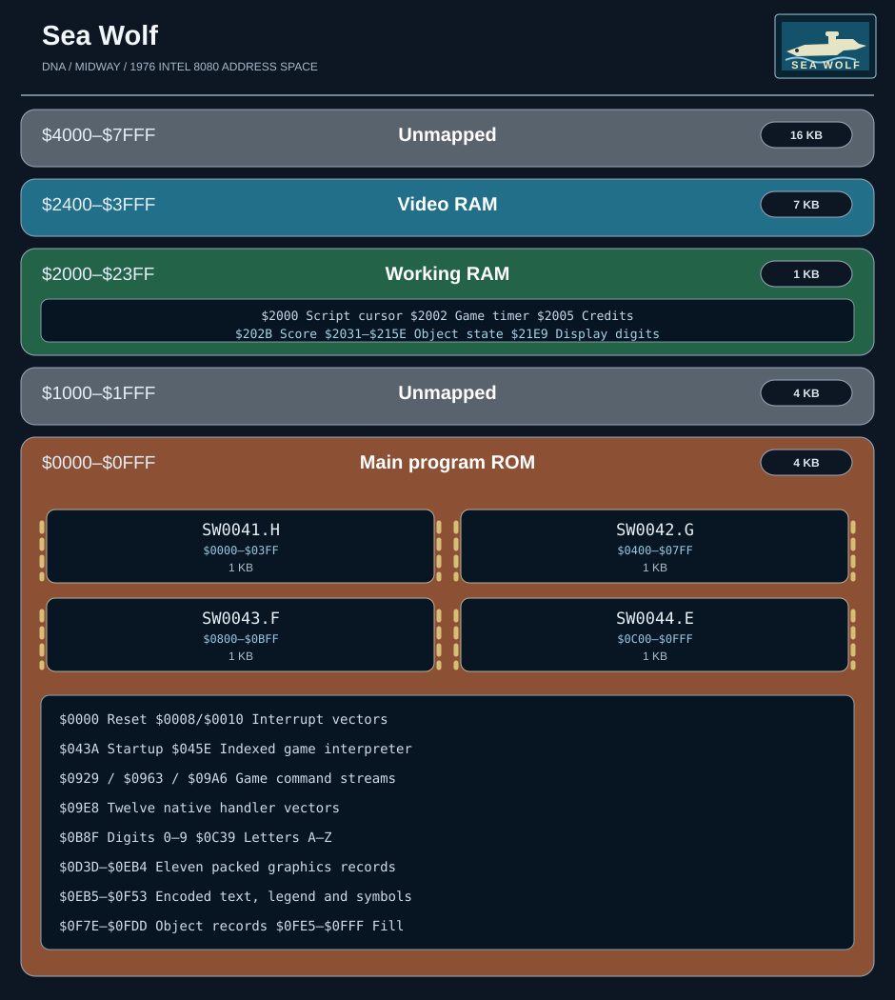
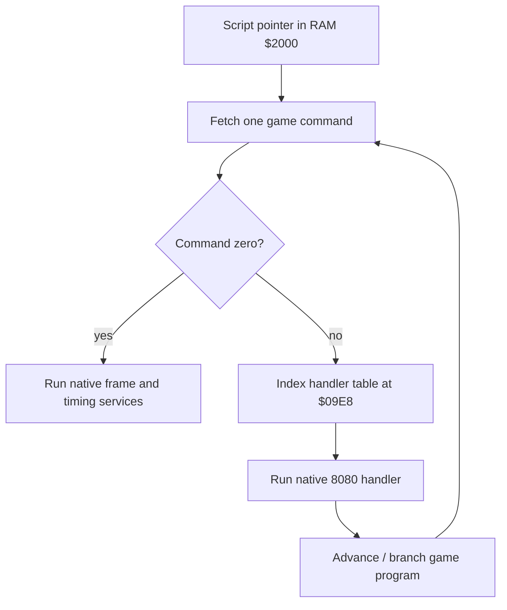

# Sea Wolf

1976 Midway / Dave Nutting Associates **Intel 8080 arcade game**. 

This is the original periscope cabinet, distinct from the Z80 Sea Wolf II and the Astrocade SeaWolf/Missile cartridge. 

The cabinet combines the CRT image with an optical periscope/crosshair and physical torpedo/reload lamps and reflected explosion lamps. Separate peripheral boards include the PC 596-906 periscope commutator, PC 596-907 explosion lights, and PC 596-908 periscope lights, as identified in the original service data.


Sea Wolf's game-specific drawing code uses the MB14241 barrel-shifter device. 


The original PC 596-909 sound generator is a dedicated discrete analog board, not an Astrocade sound chip. Its board controls separately adjust sonar volume, rate and pitch; torpedo volume; dive volume and tone; ship-hit explosion volume; mine explosion volume; and master volume. 


## Build

**Linux**
```sh
./build.sh
```

**Windows**
```bat
build.bat
```

**MAME**
```sh
mame -window -rompath roms seawolf 
```

## Memory map

| Address | Purpose |
| --- | --- |
| `$0000–$03FF` | sw0041.h — reset, interrupts, core display/game services |
| `$0400–$07FF` | sw0042.g — main game loop, indexed interpreter, movement/events |
| `$0800–$0BFF` | sw0043.f — game programs, command/data tables, native routines |
| `$0C00–$0FFF` | sw0044.e — character graphics, display legends, ship/projectile frames and descriptor tables |
| `$2000–$2001` | Interpreted game-program pointer |
| `$2002–$2030` | Timers, credits, score, input and scheduler working state |
| `$2031–$215E` | Ship, mine and torpedo object descriptors |
| `$21E9–$21EF` | Time/score character buffer |
| `$2400+` | Monochrome display memory / bitmap |




| ROM | Address | SHA-1 |
| --- | --- | --- |
| sw0041.h | `$0000–$03FF` | `b538277d3a633dd8a3179cff202f18d322e6fe17` |
| sw0042.g | `$0400–$07FF` | `cc2a99b18695f61e0540c9f6bf8fe3b391dde4a0` |
| sw0043.f | `$0800–$0BFF` | `385198434b08fe4651ad2c920d44fb49cfe0bc33` |
| sw0044.e | `$0C00–$0FFF` | `bd345dd72fed8ce15da76c381782b025f71b006f` |


## Interpreter

Sea Wolf uses a 12-command interpreter to control gameplay. 

Instead of programming every action directly in assembly, DNA created compact scripts that call native routines to display graphics, update scores, read controls, manage timing, and control game events. 

The interpreter works alongside the game's interrupt routines, which handle ship movement, torpedoes, and other real-time activity. This approach allowed DNA to build complex gameplay using a small set of reusable commands, an early example of DNA's game-specific interpreted languages. 



