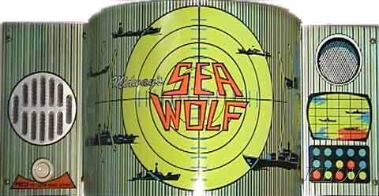
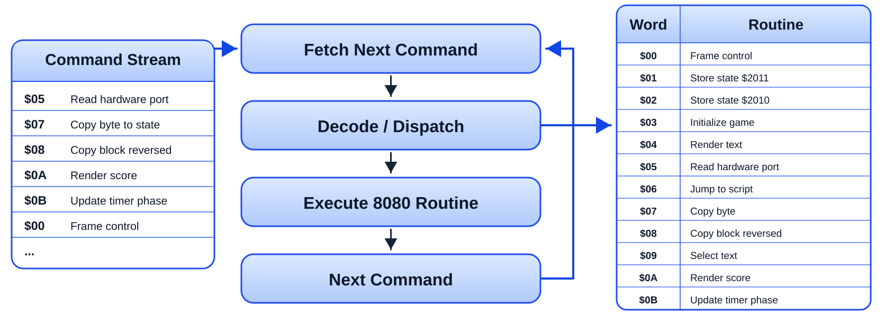
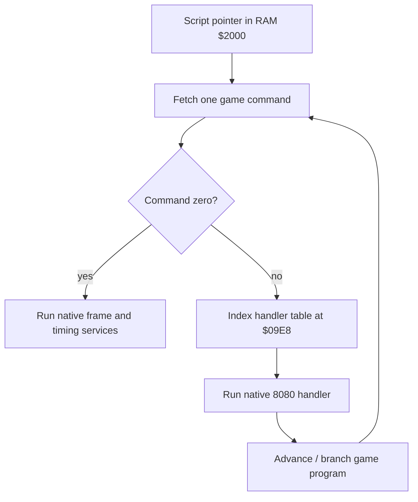

# Sea Wolf

1976 Midway / Dave Nutting Associates **Intel 8080 arcade game**. 

External barrel shifter and discrete sound circuitry. See the repository's circuit and service PDFs under `docs/`.



## Build

**Linux**
```sh
./build.sh
```

**Windows**
```bat
build.bat
```

**MAME**
```sh
mame -window -rompath roms seawolf 
```

## Memory map

| Address | Purpose |
| --- | --- |
| `$0000–$03FF` | sw0041.h — reset, interrupts, core display/game services |
| `$0400–$07FF` | sw0042.g — main game loop, indexed interpreter, movement/events |
| `$0800–$0BFF` | sw0043.f — game programs, command/data tables, native routines |
| `$0C00–$0FFF` | sw0044.e — character graphics, display legends, ship/projectile frames and descriptor tables |
| `$2000–$2001` | Interpreted game-program pointer |
| `$2002–$2030` | Timers, credits, score, input and scheduler working state |
| `$2031–$215E` | Ship, mine and torpedo object descriptors |
| `$21E9–$21EF` | Time/score character buffer |
| `$2400+` | Monochrome display memory / bitmap |


| ROM | Address | SHA-1 |
| --- | --- | --- |
| sw0041.h | `$0000–$03FF` | `b538277d3a633dd8a3179cff202f18d322e6fe17` |
| sw0042.g | `$0400–$07FF` | `cc2a99b18695f61e0540c9f6bf8fe3b391dde4a0` |
| sw0043.f | `$0800–$0BFF` | `385198434b08fe4651ad2c920d44fb49cfe0bc33` |
| sw0044.e | `$0C00–$0FFF` | `bd345dd72fed8ce15da76c381782b025f71b006f` |


## Interpreter

At `$045E` the native engine reads an interpreted command from the pointer stored at `$2000`, and selects a native operation using the table beginning at `$09E8`. 




