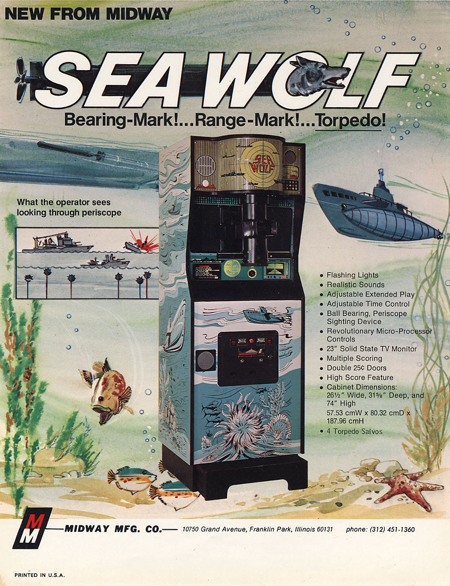
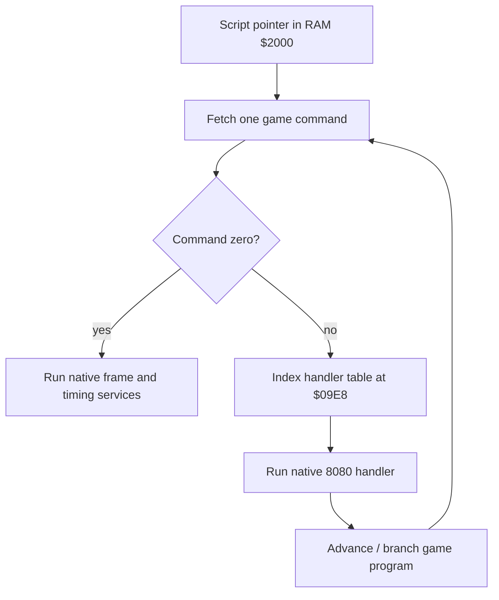

# Sea Wolf

1976 Midway / Dave Nutting Associates **Intel 8080 arcade game**. This is the original black-and-white arcade cabinet, **not** the Z80 Astrocade *SeaWolf/Missile* cartridge or 1978 *Sea Wolf II*.



## Reconstruction

`src/seawolf.asm` reconstructs the **four original 1 KB ROMs** as a 4 KB address-space image. Native 8080 instructions are expressed in zmac's Z80-compatible syntax where instruction bytes have been checked against the original ROM. Indexed bytecode scripts, sprite descriptors, vectors, graphics and other data remain byte-preserving directives where appropriate. The interpreter at `$045E` uses a game-program pointer at `$2000` and a native-handler lookup table at `$09E8`.

The original ROMs were compared against an independently annotated historic disassembly. That disassembly also contains later experimental changes; **the archived 1976 ROM files—not the modified code—are authoritative**. Areas not reliably recovered as native code are left as `DB` and explicitly bounded rather than silently misidentifying image data or interpreter operands as instructions.

## Memory map


| Address | Purpose |
| --- | --- |
| `$0000–$03FF` | sw0041.h — reset, interrupts, core display/game services |
| `$0400–$07FF` | sw0042.g — main game loop, indexed interpreter, movement/events |
| `$0800–$0BFF` | sw0043.f — game programs, command/data tables, native routines |
| `$0C00–$0FFF` | sw0044.e — further services, sprites and object data |
| `$2000–$2001` | Interpreted game-program pointer |
| `$2002–$2030` | Timers, credits, score, input and scheduler working state |
| `$2031–$215E` | Ship, mine and torpedo object descriptors |
| `$21E9–$21EF` | Time/score character buffer |
| `$2400+` | Monochrome display memory / bitmap |

Hardware: original Midway 8080 black-and-white video system; external barrel shifter and discrete sound circuitry. See the repository's circuit and service PDFs under `docs/`.

## Build (zmac v1.3)

From the repository root:

**Linux**
```sh
chmod +x build.sh
./build.sh
```

**Windows**
```bat
build.bat
```

Build scripts use the supplied `tools/zmac` / `tools/zmac.exe` directly. They assemble `src/seawolf.asm`, split it into four 1 KB chip files, verify the official original-ROM SHA-1 values, and package `roms/seawolf.zip` for MAME. No Python, Maven, or GitHub Actions.

| ROM | Address | SHA-1 |
| --- | --- | --- |
| sw0041.h | `$0000–$03FF` | `b538277d3a633dd8a3179cff202f18d322e6fe17` |
| sw0042.g | `$0400–$07FF` | `cc2a99b18695f61e0540c9f6bf8fe3b391dde4a0` |
| sw0043.f | `$0800–$0BFF` | `385198434b08fe4651ad2c920d44fb49cfe0bc33` |
| sw0044.e | `$0C00–$0FFF` | `bd345dd72fed8ce15da76c381782b025f71b006f` |

```sh
mame seawolf -window -skip_gameinfo -rompath roms
```

## The indexed game interpreter

At `$045E` the native engine reads an interpreted command from the pointer stored at `$2000`, and selects a native operation using the table beginning at `$09E8`. Its native handlers implement game behavior, while command bytes and inline operands describe what happens next.



This is evidence of DNA's evolving **numbered native game-word** architecture, preceding the later named, composable Z80 TERSE language. It is not evidence that Sea Wolf's 8080 source was written in Forth.

## Repository

`src/seawolf.asm`  
Original-address, mixed native-assembly/data disassembly of the four ROMs.

`build.sh` / `build.bat`  
Original ROM reconstruction, splitting, SHA-1 verification and packaging.

`images/seawolf-memory-map.svg`  
Editable source diagram identifying ROM, interpreter, RAM and display domains.

`roms/original/seawolf.zip`  
Reference MAME ROM set, retained unchanged.

`docs/`  
Contemporary Sea Wolf service, graphics and sound documents.

**Research context:** Gorf/TERSE follows a different Z80 direct-threaded execution model, not a direct bytecode continuation. The source baseline here is intended for the next DNA 8080 interpreter ancestry comparison.
