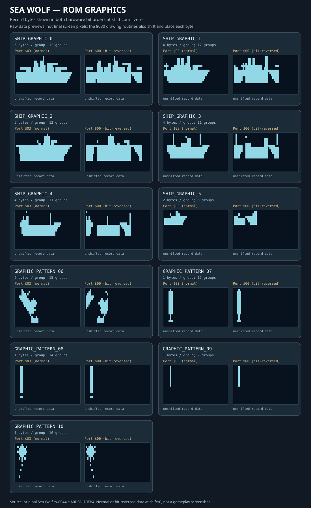

# Sea Wolf (1976) — reverse-engineering record

Version: v20261121-0001

## Source authority and method

- The four original ROMs (`sw0041.h`, `sw0042.g`, `sw0043.f`, `sw0044.e`) are byte authority. The original `roms/original/seawolf.zip` stays unchanged.
- Original native Intel 8080 instructions remain assembled with the bundled zmac v1.3. No custom decoder, substitute compiler, or runtime implementation has been introduced.
- Source classification follows actual code references and observable byte patterns. Names inferred from a single call site require continued verification; no undocumented DNA-era symbol names are claimed.
- Checksums provided in the unchanged build script: `b538277d…`, `cc2a99b1…`, `38519843…`, `bd345dd7…`. These remain build targets, not a claim that this PR's build has already passed.

## Native interpreter and interpreted scripts

The dispatcher at `$045E` fetches its command from the program pointer in RAM `$2000`. A zero byte enters the native frame-control path. A nonzero byte is doubled (`RLCA`) and added to the table base `$09E8`; this makes the **first word a reserved $00 entry**, not command $01. The original table has eleven executable command numbers, **$01–$0B**.

| Command | Native address | Handler symbol | Operation |
| --- | --- | --- | --- |
| Reserved $00 | $08C7 | `CMD_RETURN` | Unused table word; dispatcher handles zero separately |
| $01 | $0B7C | `SCRIPT_STORE_STATE_2011` | Read one inline byte; write $2011 |
| $02 | $0B72 | `SCRIPT_STORE_STATE_2010` | Read one inline byte; write $2010 |
| $03 | $08A2 | `INITIALIZE_GAME_STATE` | Reset game state and draw startup display |
| $04 | $0B22 | `CMD_RENDER_TEXT` | Inline byte count, source address, video destination |
| $05 | $0AED | `CMD_READ_HARDWARE_PORT` | Build and execute a RAM `IN port; RET` stub |
| $06 | $0B86 | `SCRIPT_JUMP_ABSOLUTE` | Read 16-bit inline address and replace program cursor |
| $07 | $0AE1 | `CMD_COPY_POINTED_BYTE` | Write one immediate byte to a 16-bit destination |
| $08 | $0A9F | `CMD_COPY_INLINE_BYTES_REVERSED` | Inline count, destination and byte payload; descending destination |
| $09 | $0ABC | `CMD_SELECT_AND_RENDER_TEXT` | Read four inline word addresses and choose one encoded string |
| $0A | $0A53 | `CMD_RENDER_SCORE` | Format packed BCD score and render four characters |
| $0B | $086D | `CMD_ADVANCE_AND_SET_TIMER_PHASE` | Update program pointer and timer-derived phase value |

The eleven handler symbols and the reserved entry are defined in native assembly at their exact ROM addresses. Their `DW` table operands are symbols, not copied numerical addresses.

### Interpreted game-command streams

The three marked streams now have **34 complete command records occupying 144 original ROM bytes**. The first stream starts at `$0929` (58 bytes, 13 commands), the second at `$0963` (67 bytes, 14 commands), and the auxiliary at `$09A6` (19 bytes, 7 commands). Every command is represented by a named `SCRIPT_*` opcode, with `DB` for bytes and `DW` for original little-endian 16-bit operands. Re-expanding all directives reproduces the original 144 bytes exactly.

The first six source bytes at `$0929` decode as:

```asm
        DB SCRIPT_RENDER_TEXT
        DB $01                  ; one glyph
        DW $0EB8               ; encoded text source
        DW $3E30               ; video destination
```

The next command at `$092F` is `SCRIPT_SELECT_TEXT`, referring to selector `$2005`, video buffer `$3833` and two text strings at `$0EE6` and `$0EF1`. This is the same control structure used by the runtime at `$0ABC`.

Frame-control bytes are preserved as `SCRIPT_FRAME_CONTROL`, not treated as unallocated padding. For example the primary stream at `$0956` and `$095F` contains zero-frame commands, followed by a jump at `$0960` back to `$094E`. The secondary stream contains two counted reverse-copy operations (command `$08`) at `$0983` and `$0993`, used to initialize game state tables.

The auxiliary stream ends with `SCRIPT_UPDATE_TIMER_PHASE` at `$09B8`. There are no unparsed bytes between these stream boundaries and the following packed input-code table.

### Native service and input tables

`$09B9–$09C9` holds two packed input-code tables. `$09CA–$09E7` contains fifteen little-endian native address entries, separate from the twelve-word interpreter dispatch table at `$09E8`. The source documents them as `DW` entries; their specific input-trigger conditions require more call-site tracing.

### Character graphics and prefixes

`$0B8F–$0BF2`: ten numeric glyphs, 10 bytes each, each row illustrated in source.

`$0BF3–$0BFF`: thirteen trailing bytes, now shown individually with eight-bit patterns. These are outside the ten complete numeric glyphs; no invented eleventh character label is assigned.

`$0C00–$0C38`: 57 bytes between numeric and alphabetic fonts. Their byte patterns are illustrated individually; their exact rendering/control interpretation is not yet established.

`$0C39–$0D3C`: 26 uppercase glyphs, 10 rows each.

### Six ship graphics and five smaller graphic records

A record consists of **one byte width (bytes per scanline), one byte height (scanlines), then width × height raster bytes**. The end of each record coincides exactly with the next header. The six ship graphics are identified through the native spawn path at `$064A–$06A3`: it reads the ship-type selector at `$0FDE`, uses `$0F7E` or `$0FAE` as a directional descriptor base, copies an eight-byte record into RAM, and supplies its graphics pointer to the renderer. Both sets of six records point to the same six ROM graphics, with direction/movement parameters differing between groups.

| Record | Address range | Header | Raster payload |
| --- | --- | --- | --- |
| 0 | `$0D3D–$0D7A` | 5 × 12 | 60 bytes |
| 1 | `$0D7B–$0DAC` | 4 × 12 | 48 bytes |
| 2 | `$0DAD–$0DEA` | 5 × 12 | 60 bytes |
| 3 | `$0DEB–$0E18` | 4 × 11 | 44 bytes |
| 4 | `$0E19–$0E46` | 4 × 11 | 44 bytes |
| 5 | `$0E47–$0E54` | 2 × 6 | 12 bytes |
| 6 | `$0E55–$0E74` | 2 × 15 | 30 bytes |
| 7 | `$0E75–$0E87` | 1 × 17 | 17 bytes |
| 8 | `$0E88–$0E97` | 1 × 14 | 14 bytes |
| 9 | `$0E98–$0EA2` | 1 × 9 | 9 bytes |
| 10 | `$0EA3–$0EB4` | 1 × 16 | 16 bytes |

The first six are now labeled `SHIP_GRAPHIC_0` through `SHIP_GRAPHIC_5`, based on the ROM-to-RAM spawn references. Their raw `DB` strips remain byte-exact. The initial inline ASCII art presented bits as though the ROM bytes were final horizontal pixels; that omitted the actual bit order and shifter processing.

The two directional groups are selected by the branch at `$0680–$068A`: the first begins at `$0F7E`; the second at `$0FAE` and sets object flag bit `$10`. The ship drawing caller at `$013A–$0162` tests that same bit, taking the normal shifter path when clear and the bit-reversed/descending-address path when set. Therefore the two directional descriptor groups are explicitly tied to the two rendering paths, rather than merely inferred from duplicate graphics pointers.

The renderer at `$0165` derives a sub-byte shift and sets it with `OUT ($04),A`. The normal drawing path at `$0192` writes each byte with `OUT ($03),A`, reads `IN ($03)`, and writes the shifted result to screen RAM. The alternate path at `$01B8` instead reads `IN ($00)` and walks the destination address backward. Both feed a final zero byte through the shifter before proceeding to the next `$20`-byte video-RAM column. The normal path's loop termination is based on display-memory boundaries rather than an explicit decrement of the header's second byte. Thus the header-derived record height is an exact **ROM record length**, but does not by itself prove that the screen renderer emits only that many strips.

[MAME's Sea Wolf hardware map](https://github.com/mamedev/mame/blob/master/src/mame/midw8080/mw8080bw.cpp) confirms that port `$03` reads the normal MB14241 result and port `$00` reads that result with bits reversed. [Its MB14241 device](https://github.com/mamedev/mame/blob/master/src/devices/machine/mb14241.cpp) computes `shift_count = ~value & 7` and combines successive writes before selecting the eight-bit output. These precise I/O semantics explain why bit order, shift amount and screen placement must be handled before claiming a final displayed ship silhouette.



The new SVG contains **all eleven original graphic records** rendered from their literal ROM bytes in the two MAME-supported bit orientations at shift count zero. These bit-exact previews prove record grouping and bit order; they are explicitly not a substitute for MAME's composited, position-dependent screen output. The RE remains active for full position/shift reproduction and screenshot matching.

### Encoded text

`$0EC3–$0F03` stores text using `$40` for spacing, including `GAME OVER`, `HIGH SCORE`, `YOUR SCORE`, `INSERT COIN`, `PUSH BUTTONS`, and `SEA WOLF`. A shared `S` at `$0EFC` is both the last character of `PUSH BUTTONS` and the first of `SEA WOLF`. Each supported text start has a source label; source bytes stay unchanged.

The following `$0F04–$0F23` holds a repeated `$3A–$3C` display-symbol sequence, distinct from the `$0F24–$0F53` display legend and control bytes.

### Object record table and EOF fill

`$0F7E–$0FDD` holds twelve eight-byte descriptor records, preceded by a six-byte lookup tail at `$0F78–$0F7D`. Their first two bytes encode a **high-byte-first graphic pointer**, e.g. bytes `0D 3D` at `$0F7E` refer to `$0D3D`. Normal 8080 `DW` would reverse this byte order and is therefore inappropriate for those fields. The existing `$0F7E` reference points to the first record's graphic pointer. The preceding six bytes are not part of a descriptor. The previous eight-byte grouping beginning at `$0F78` was incorrect and has been replaced. Remaining descriptor field meanings and object identities need caller analysis.

`$0FDE–$0FE4` contains seven trailing object-control bytes.

`$0FE5–$0FFF` is exactly 27 consecutive `$FF` bytes. The earlier linear disassembly expressed each as `RST $38` because Intel 8080 opcode `$FF` is `RST 7`; execution would jump to `$0038`. There is no verified code path into this region, so it is documented as ROM fill with 27 explicit `DB $FF` bytes, not active reset instructions. Its original programming rationale is unverified.

### Integrity method

The data edits were independently checked by expanding literal `DB` values before and after rewriting: script/lookup data 191 bytes, numeric trailer 13 bytes, pre-alphabet data 57 bytes, graphic/text block 487 bytes, legend data 48 bytes, final lookup/descriptors 145 bytes. Handler vectors were converted into twelve `DW` values (one reserved) with the same low-byte-first addresses. The 27-byte tail remains all `$FF`.

These are **source-level byte checks**, not a zmac-assembled ROM comparison. The original four ROM hashes and MAME execution remain mandatory validation gates.

## RE inventory

| ID | Status | Verification criterion |
| --- | --- | --- |
| SW-RE-001 | Partial | Replaced all 111 remaining address-only branch labels with context names; labels and branch roles remain reviewable against execution tracing |
| SW-RE-002 | Partial | Verified reserved table entry and 11 native commands, decoded 34 script commands into symbolic opcodes and typed operands; finish native operand/stack contracts |
| SW-RE-003 | Partial | Six ship graphics tied to the native spawn routine, eleven ROM graphics previewed in normal/reversed bit order; reproduce sub-byte shift and full screen placement in MAME |
| SW-RE-004 | Partial | All 36 glyphs plus thirteen trailer and 57 pre-alphabet bytes shown inline; verify interpretation of non-glyph data |
| SW-RE-005 | Partial | Twelve eight-byte descriptor records split and graphic pointer byte-order verified; decode remaining fields against callers |
| SW-RE-006 | Open | Build with `./build.sh` using bundled zmac v1.3; confirm the 4096-byte image and all four SHA-1 hashes |
| SW-RE-007 | Open | Run `mame seawolf -rompath roms -window -skip_gameinfo`, verify input, sound, score, sprites and game progression |
| SW-RE-008 | Open | Recover verified hardware I/O bit definitions from the actual program and board documentation |

## Verification record

**Performed:** MAME Sea Wolf I/O and MB14241 source inspection, native handler control-flow inspection, identification of six original ship graphics from the spawn path, and byte-exact ROM previews for both shifter bit orientations.  Direct Checkmate source-style comparison, source-label naming pass (no remaining `Lxxxx` labels), 36 inline 8×10 font glyphs, eleven inline graphic records, twelve object descriptors, named scripts/lookup boundaries, eleven indexed handlers plus a reserved `DW` table slot and 27 explicit `$FF` fill bytes. Source-level checks compared every rewritten data byte and found no mismatch in the verified regions; static named CALL/JP checks found no missing label references. Memory-map SVG and build destinations were revised.

**Not performed:** Native zmac invocation, checksum verification of newly assembled output, MAME execution, physical cabinet execution. The updated build writes to `build/` and creates ignored `roms/seawolf.zip`.

No ROM payload, build toolchain, interpreter, XC, original reference images or hardware interface has been deliberately changed. The ROM checksum gate remains mandatory before merge.
